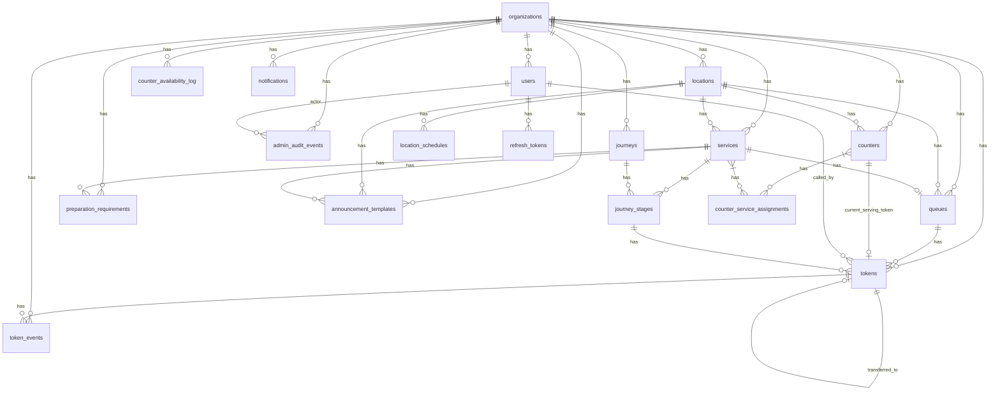

# ALIGN BACKEND — DATABASE SCHEMA

**Version:** 2.0 (Phase 8 MVP)
**Last Updated:** 2026-10-03
**Database:** PostgreSQL 15+
**Migration Tool:** Flyway

---

## Entity Relationship Diagram

---

## Flyway Migrations Sequence

The schema is strictly managed by Flyway. The actual migration sequence in `backend/src/main/resources/db/migration/` is:

1. `V1__foundation.sql` - Base schema info and baseline setup
2. `V2__security.sql` - Core `organizations`, `users`, `refresh_tokens` tables
3. `V3__organization_domain.sql` - `locations`, `services`, `queues`, `counters`
4. `V4__token_engine.sql` - Core `tokens`, `token_events` tables and constraints
5. `V5__staff_operations.sql` - Staff roles and initial counter operation logic
6. `V6__add_display_role.sql` - Display-specific roles for Public TV
7. `V7__phase6_administration_analytics.sql` - `admin_audit_events`, `counter_availability_log`, added `org_id` to `token_events`
8. `V8__phase6_analytics_indexes.sql` - High-performance indexes for metrics
9. `V9__global_operational_rules.sql` - Added `capacity_threshold_percent`, `max_wait_threshold_mins` to organizations
10. `V10__counter_service_assignments.sql` - Added `counter_service_assignments` table
11. `V11__queue_warning_state.sql` - Added warning flags to `queues`
12. `V12__token_transfer.sql` - Added `transferred_to_token_id`, `priority_timestamp`, `TRANSFERRED` state to tokens
13. `V13__phase7_notifications.sql` - Added `notifications` table for SMS/Email
14. `V14__structured_operating_hours.sql` - Added `timezone`, `enforce_schedule` to locations and created `location_schedules`
15. `V15__phase7_customer_sms_consent.sql` - Added `sms_consent`, `sms_consent_timestamp` to tokens
16. `V16__phase8_mvp_gaps.sql` - Added `journeys`, `journey_stages`, `preparation_requirements`, `announcement_templates`, updated queues and tokens.

---

## Table Definitions

### 1. organizations
**Purpose:** Multi-tenant organization registry.
- **Primary Key:** `id` (UUID)
- **Important Columns:** 
  - `code` (VARCHAR(20), UNIQUE)
  - `status` (VARCHAR(20)) - ACTIVE / SUSPENDED
  - `capacity_threshold_percent` (SMALLINT)
  - `max_wait_threshold_mins` (INTEGER)

### 2. users
**Purpose:** System users (staff, admins, displays).
- **Primary Key:** `id` (UUID)
- **Foreign Keys:** `org_id` (organizations), `location_id` (locations)
- **Important Columns:** `email` (UNIQUE), `password_hash`, `role`, `status`

### 3. refresh_tokens
**Purpose:** JWT refresh token persistence.
- **Primary Key:** `id` (UUID)
- **Foreign Keys:** `user_id` (users, CASCADE)
- **Important Columns:** `token` (UNIQUE), `expires_at`

### 4. locations
**Purpose:** Physical branch/office locations.
- **Primary Key:** `id` (UUID)
- **Foreign Keys:** `org_id` (organizations, CASCADE)
- **Important Columns:** 
  - `timezone` (VARCHAR(50), e.g., 'UTC')
  - `enforce_schedule` (BOOLEAN)
  - `is_hq` (BOOLEAN)
  - `status` (ACTIVE / INACTIVE)

### 5. location_schedules
**Purpose:** Structured operating hours per location per day.
- **Primary Key:** `id` (UUID)
- **Foreign Keys:** `location_id` (locations, CASCADE)
- **Important Columns:** 
  - `day_of_week` (INTEGER, 1-7)
  - `open_time` (TIME)
  - `close_time` (TIME)

### 6. services
**Purpose:** Service offerings at each location.
- **Primary Key:** `id` (UUID)
- **Foreign Keys:** `org_id` (organizations, CASCADE), `location_id` (locations, CASCADE)
- **Important Columns:** `name`, `enabled`, `is_fast_track`

### 7. preparation_requirements
**Purpose:** Pre-requisites for a service.
- **Primary Key:** `id` (UUID)
- **Foreign Keys:** `org_id` (organizations), `service_id` (services, CASCADE)
- **Important Columns:** `title`, `is_required`, `display_order`, `is_active`

### 8. queues
**Purpose:** Queue configuration and atomic generation per service.
- **Primary Key:** `id` (UUID)
- **Foreign Keys:** `org_id` (organizations, CASCADE), `location_id` (locations, CASCADE), `service_id` (services, CASCADE)
- **Unique Constraints:** `service_id` (1:1 with service)
- **Important Columns:** 
  - `next_token_number` (BIGINT) - Atomic counter
  - `token_prefix` (CHAR(5))
  - `capacity_warning_active` (BOOLEAN)
  - `wait_warning_active` (BOOLEAN)
  - `default_service_duration_minutes` (INT)
  - `status` (ACTIVE, PAUSED, CLOSED)

### 9. counters
**Purpose:** Service counters/stations.
- **Primary Key:** `id` (UUID)
- **Foreign Keys:** `org_id` (organizations, CASCADE), `location_id` (locations, CASCADE), `assigned_staff_id` (users), `current_serving_token_id` (tokens)
- **Unique Constraints:** `(location_id, number)`
- **Important Columns:** `availability` (ONLINE, ON_BREAK, AWAY, OFFLINE), `status` (ACTIVE, PAUSED, CLOSED)

### 10. counter_service_assignments
**Purpose:** Many-to-many assignments of which counters serve which services.
- **Primary Key:** `id` (UUID)
- **Foreign Keys:** `counter_id` (counters), `service_id` (services)
- **Unique Constraints:** `(counter_id, service_id)`

### 11. tokens
**Purpose:** Customer queue tokens (PRIMARY DOMAIN MODEL).
- **Primary Key:** `id` (UUID)
- **Foreign Keys:** `org_id`, `location_id`, `service_id`, `queue_id`, `counter_id`, `called_by_staff_id`, `transferred_to_token_id`, `journey_stage_id`
- **Unique Constraints:** `(queue_id, token_number)`, `idempotency_key`
- **Important Columns:** 
  - `state` (WAITING, AWAY, CALLED, IN_SERVICE, COMPLETED, NO_SHOW, CANCELLED, EXPIRED, TRANSFERRED)
  - `priority_timestamp` (TIMESTAMP WITH TIME ZONE) - For accurate wait-time tracking post-transfer
  - `sms_consent` (BOOLEAN), `sms_consent_timestamp`

### 12. token_events
**Purpose:** Immutable token lifecycle event history.
- **Primary Key:** `id` (UUID)
- **Foreign Keys:** `token_id` (tokens, CASCADE), `org_id` (organizations), `counter_id`, `actor_id`
- **Important Columns:** `event_type`, `from_state`, `to_state`, `metadata` (JSONB)

### 13. journeys
**Purpose:** Multi-service customer visits.
- **Primary Key:** `id` (UUID)
- **Foreign Keys:** `org_id` (organizations, CASCADE), `location_id` (locations, CASCADE)
- **Important Columns:** `customer_name`, `customer_phone`, `status`, `sms_consent`

### 14. journey_stages
**Purpose:** Individual service steps within a journey.
- **Primary Key:** `id` (UUID)
- **Foreign Keys:** `journey_id` (journeys, CASCADE), `service_id` (services, CASCADE)
- **Important Columns:** `sequence_order`, `status`

### 15. admin_audit_events
**Purpose:** Administrative action audit trail (Config changes, staff operations).
- **Primary Key:** `id` (UUID)
- **Foreign Keys:** `org_id`, `actor_id`, `entity_id`
- **Important Columns:** `action`, `entity_type`, `before_state` (JSONB), `after_state` (JSONB)

### 16. counter_availability_log
**Purpose:** Immutable log of counter availability state changes.
- **Primary Key:** `id` (UUID)
- **Foreign Keys:** `org_id`, `location_id`, `counter_id`, `changed_by`
- **Important Columns:** `old_availability`, `new_availability`

### 17. notifications
**Purpose:** Outbox pattern table for SMS/Email notifications.
- **Primary Key:** `id` (UUID)
- **Foreign Keys:** `org_id`, `location_id`, `token_id`
- **Unique Constraints:** `idempotency_key`
- **Important Columns:** `type`, `channel`, `payload` (JSONB), `status`, `retry_count`, `next_attempt_at`

### 18. announcement_templates
**Purpose:** Customizable, localized templates for notifications and Public TV audio.
- **Primary Key:** `id` (UUID)
- **Foreign Keys:** `org_id` (organizations, CASCADE), `location_id` (locations, CASCADE), `service_id` (services, CASCADE)
- **Important Columns:** `language_code`, `event_type`, `template_text`, `is_default`

---

## Critical Database Behaviors

1. **Atomic Token Generation:** Token numbers are safely generated via `next_token_number` atomic increment.
2. **Safe Queuing (CALL NEXT):** Handled via `FOR UPDATE SKIP LOCKED` on the tokens table to ensure staff concurrently picking up customers never grab the same token.
3. **Immutable Auditing:** `token_events`, `admin_audit_events`, and `counter_availability_log` are append-only.
4. **Resilient Notifications:** `notifications` uses an outbox pattern with `idempotency_key` and `retry_count` for guaranteed delivery.
5. **Token Transfers:** Transferring a token copies customer details to a new token, links them via `transferred_to_token_id`, and retains the original `priority_timestamp`.
